# AssurRisk — Analyse et Pilotage des Sinistres

Tableau de bord décisionnel Power BI développé pour analyser l'activité des sinistres et croiser les données opérationnelles avec les facteurs météorologiques.

---

## 📋 Contexte du Projet

Au sein de l'équipe Data d'AssurRisk, ce projet vise à transformer les données internes (nettoyées et enrichies avec les relevés météorologiques externes issus de PostgreSQL) en indicateurs et visualisations exploitables pour la direction. L'objectif est de piloter l'activité liée aux sinistres à travers quatre grands axes :
1. **Vue globale de l'activité** : Suivi des KPI clés (nombre de sinistres, coût total, coût moyen, indemnisations et évolution temporelle).
2. **Typologies de sinistres** : Identification des motifs les plus fréquents, les plus coûteux et analyse des coûts moyens.
3. **Analyse géographique** : Observation des disparités par ville et par région pour repérer les zones à forte exposition.
4. **Impact de la météo** : Croisement des sinistres avec les précipitations, les rafales de vent et les codes météo (`weather_code`) pour identifier des tendances et des associations remarquables (tout en distinguant corrélation et causalité).

---

## 🛠️ Stack Technique & Outils

* **Source de données :** PostgreSQL (Base AssurRisk)
* **Outil de restitution :** Power BI Desktop (`Assurisk.pbix`)
* **Langage de modélisation :** DAX (Data Analysis Expressions)

---

## 📊 Structure du Rapport Power BI

Le tableau de bord interactif s'articule autour des sections suivantes :
* **Vue d'ensemble / Synthèse exécutive** : Indicateurs globaux et filtres croisés (période, région, statut).
* **Analyse par Typologie & Coûts** : Comparaison des volumes et de la sévérité financière par type de sinistre.
* **Cartographie & Géographie** : Répartition territoriale de l'activité et des zones à risques.
* **Corrélation Météo & Sinistres** : Analyse croisée des volumes de sinistres selon les intensités de pluie, de vent et les conditions météorologiques.

---

## 📁 Organisation des Fichiers

```text
Compte rendu du brief 11/
├── README.md
├── Assurisk.pbix
├── Assurisk page 1.png
├── Assurisk page 2.png
├── Assurisk page 3.png
├── ...
└── Assurisk page 25.png


## 📊 Aperçu du rapport

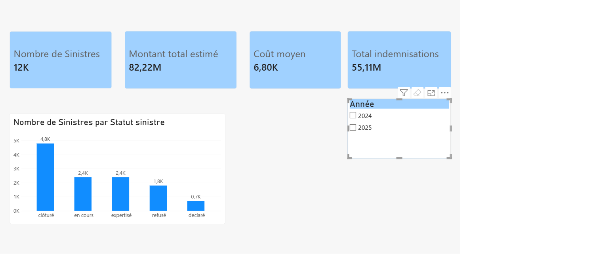


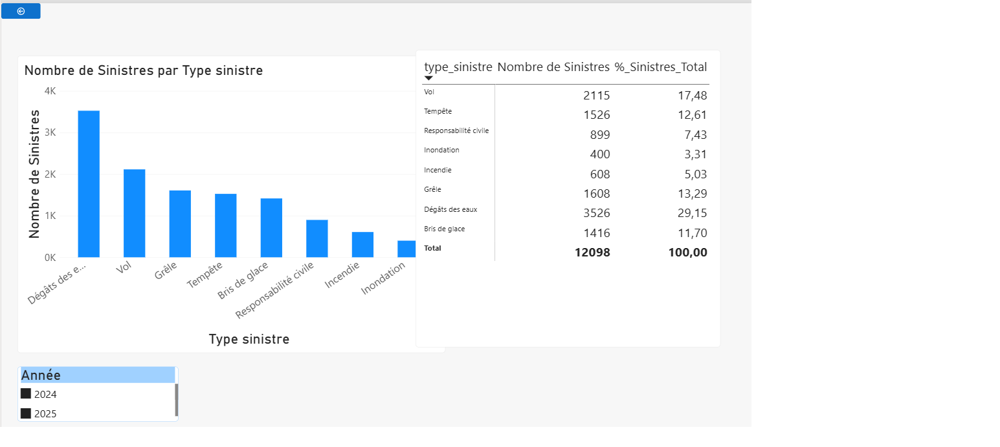


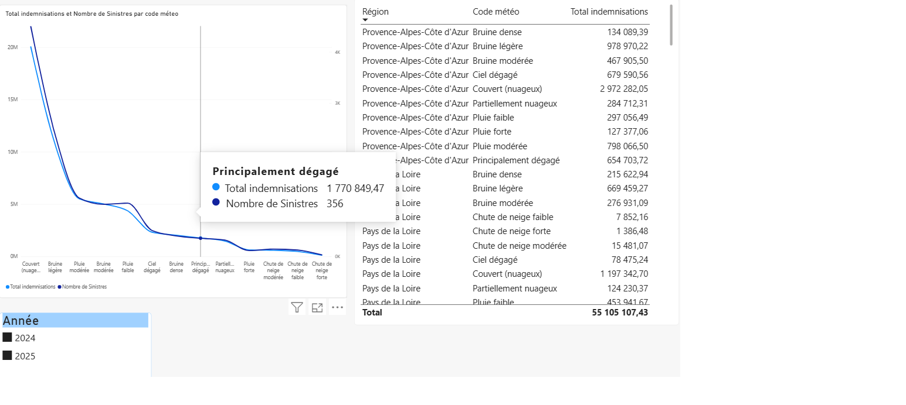

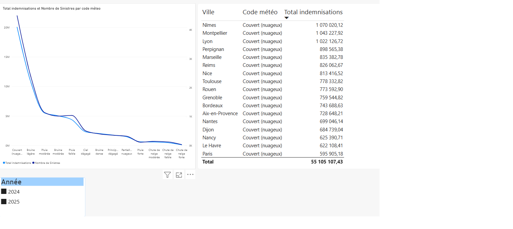

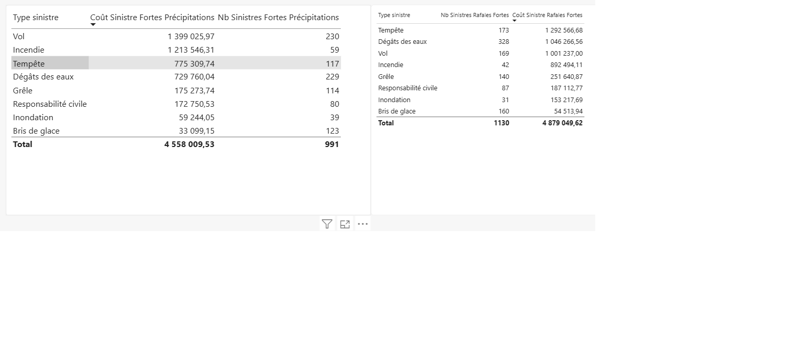

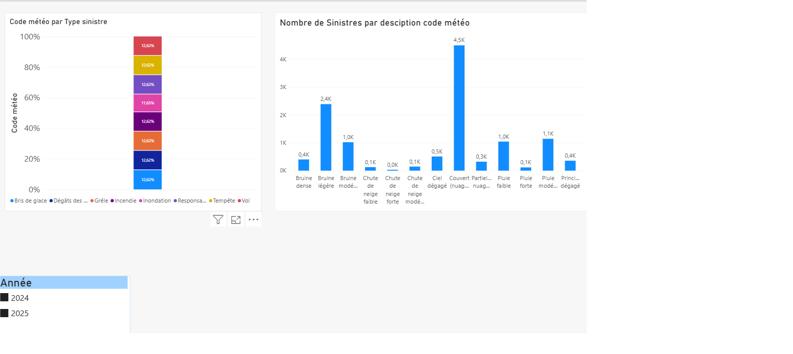


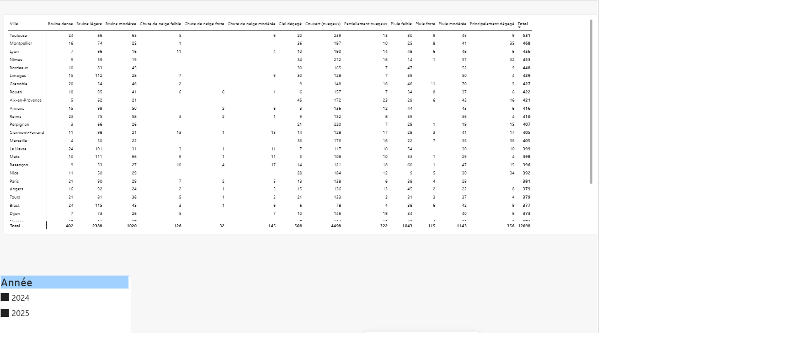

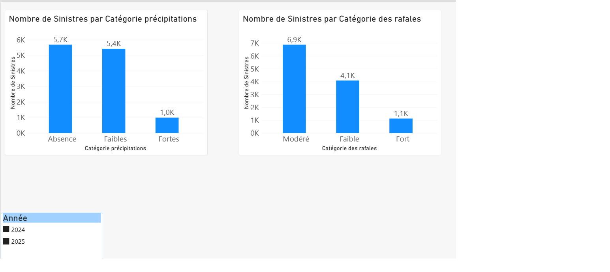

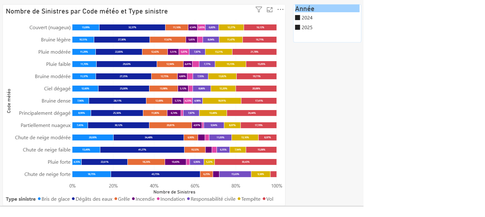

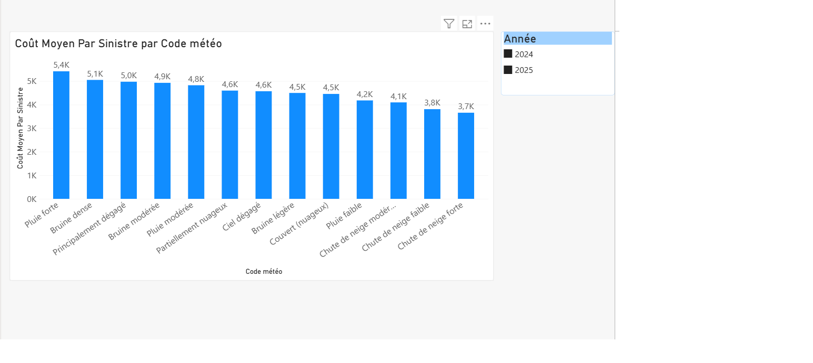

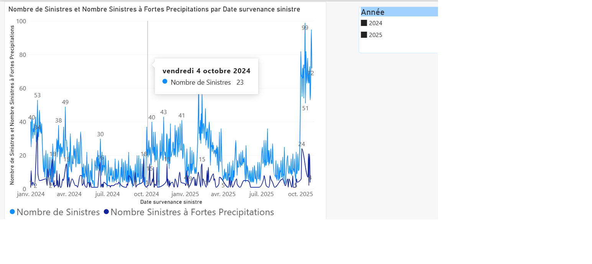


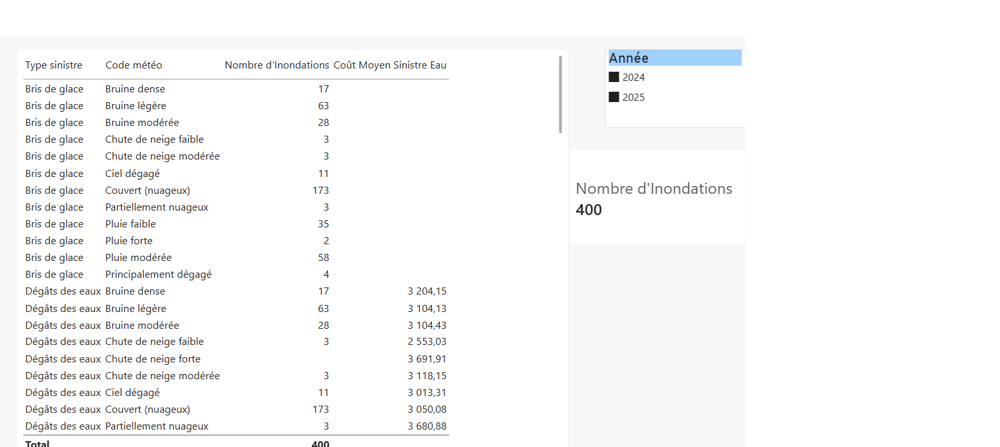

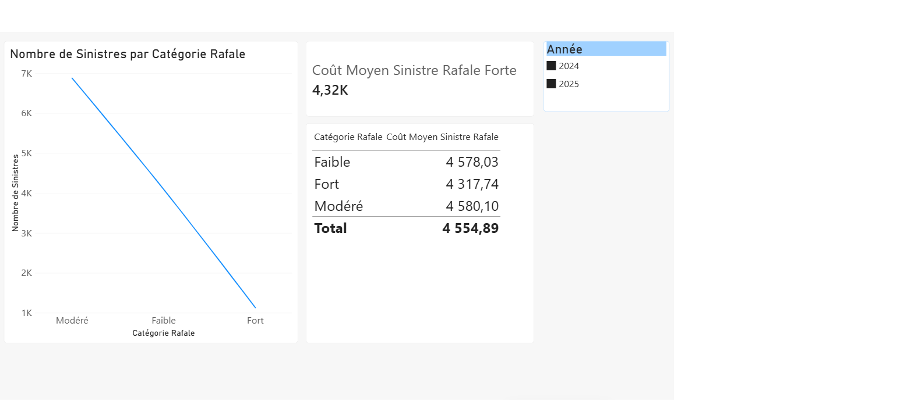


